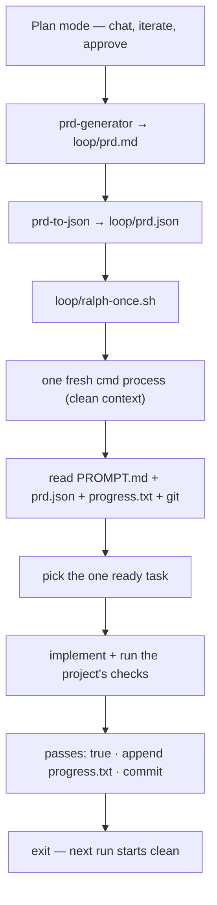

# ralph-loop

A minimal Ralph loop: every iteration is one fresh agent process. Memory lives in files, not in a long conversation.

## Flow



```
plan mode ─► PRD.md ─► prd.json ─► ralph-once.sh ─► fresh cmd process
                                        ▲                    │
                                        │      read files, pick 1 task,
                                        │      implement, verify, commit
                                        └──── next run (clean context) ──┘
```

The files are the memory: the conversation is thrown away every iteration.

## One iteration

1. `loop/ralph-once.sh` starts a fresh `cmd` process from the project root.
2. The agent reads `loop/PROMPT.md`, `loop/prd.json`, `loop/progress.txt`, and recent git history.
3. It picks exactly one ready task (a task whose `dependsOn` tasks all have `passes: true`).
4. It implements that task, then runs whatever checks the project has.
5. On success it sets the task's `passes` to `true`, appends a note to `progress.txt`, and commits.
6. It exits. The next run starts with a clean context.

## Files

```
loop/
├── PROMPT.md          one iteration's instructions
├── ralph-once.sh      runs one fresh iteration
├── prd.json.example   sample backlog (copy to prd.json)
├── prd.schema.json    shape of the backlog
├── progress.txt       append-only notes between runs
└── skills/
    ├── prd-generator/ plan or idea → loop/prd.md
    └── prd-to-json/   loop/prd.md → loop/prd.json
```

## Use

```sh
cp loop/prd.json.example loop/prd.json   # first time only
# in plan mode, work out what you want and approve the plan
/prd-generator                           # → loop/prd.md
/prd-to-json                             # → loop/prd.json
./loop/ralph-once.sh                     # run one iteration
```

Run `./loop/ralph-once.sh` again for the next task; stop when every `passes` is `true`.

The script runs `cmd -p --yolo --verbose`. Remove `--verbose` in `loop/ralph-once.sh` for a quieter run.

Skills load from `.commandcode/skills/`. If that link is missing:
`cmd --skill ./loop/skills/prd-generator --skill ./loop/skills/prd-to-json`.

Start with two or three small tasks, and a project you don't mind breaking.
