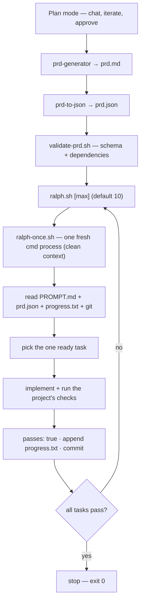

# ralph-loop

A minimal Ralph loop: every iteration is one fresh agent process. Memory lives in files, not in a long conversation.

## Flow



```
plan mode ─► PRD.md ─► prd.json ─► validate-prd.sh ─► ralph.sh ─┐
                                                                 │  one line per
                                                                 ▼  iteration
                                      ralph-once.sh ─► fresh cmd process
                                            ▲                    │
                                            │   read files, pick 1 task,
                                            │   implement, verify, commit
                                            └── next iteration ───┘
```

The files are the memory: the conversation is thrown away every iteration.

## One iteration

1. `ralph-once.sh` starts a fresh `cmd` process from the repository root.
2. The agent reads `PROMPT.md`, `prd.json`, `progress.txt`, and recent git history.
3. It picks exactly one ready task (a task whose `dependsOn` tasks all have `passes: true`).
4. It implements that task, then runs whatever checks the project has.
5. On success it sets the task's `passes` to `true`, appends a note to `progress.txt`, and commits.
6. It exits. The next run starts with a clean context.

## The loop

`ralph.sh` runs iterations until the backlog is done or it has to stop. It first
validates `prd.json`, then prints one line per iteration — the iteration out of the
total, and the task it is working on — and runs `ralph-once.sh`:

```
[1/10] TASK-001 - Add the user account data model
  done - 5 task(s) remaining
[2/10] TASK-002 - Implement login authentication
  done - 4 task(s) remaining
```

It stops early when every task passes (`exit 0`), or when the agent reports
`BLOCKED`/`FAILED`, when the agent exits non-zero, when `prd.json` stops changing,
or when it reaches the iteration limit (all `exit 1`). Each iteration's full agent
output is written to `.ralph/logs/iteration-N.log` (gitignored).

## Validating prd.json

`validate-prd.sh` checks the backlog against `prd.schema.json`: every required
top-level and per-task field, the declared value shapes, and the rules a schema
cannot express — unique ids, dependencies that resolve, and no dependency cycles.
`ralph.sh` runs it before the first iteration.

```sh
./validate-prd.sh              # validates ./prd.json
./validate-prd.sh other.json   # or a specific file
```

## Files

```
├── PROMPT.md          one iteration's instructions
├── ralph.sh           bounded loop (default 10 iterations)
├── ralph-once.sh      runs one fresh iteration
├── validate-prd.sh    prd.json schema + dependency validator
├── prd.json.example   sample backlog (copy to prd.json)
├── prd.schema.json    shape of the backlog
├── progress.txt       append-only notes between runs
└── skills/
    ├── prd-generator/ plan or idea → prd.md
    └── prd-to-json/   prd.md → prd.json
```

## Use

```sh
cp prd.json.example prd.json             # first time only
# in plan mode, work out what you want and approve the plan
/prd-generator                           # → prd.md
/prd-to-json                             # → prd.json
./validate-prd.sh                        # check the backlog
./ralph.sh                               # run up to 10 iterations
./ralph.sh 3                             # or a different limit
```

Run `./ralph-once.sh` instead to do exactly one iteration by hand. It runs
`cmd -p --yolo --verbose`; remove `--verbose` for a quieter run. `ralph.sh` needs
`jq` on `PATH`.

Skills load from `.commandcode/skills/`. If that link is missing:
`cmd --skill ./skills/prd-generator --skill ./skills/prd-to-json`.

Start with two or three small tasks, and a project you don't mind breaking.
