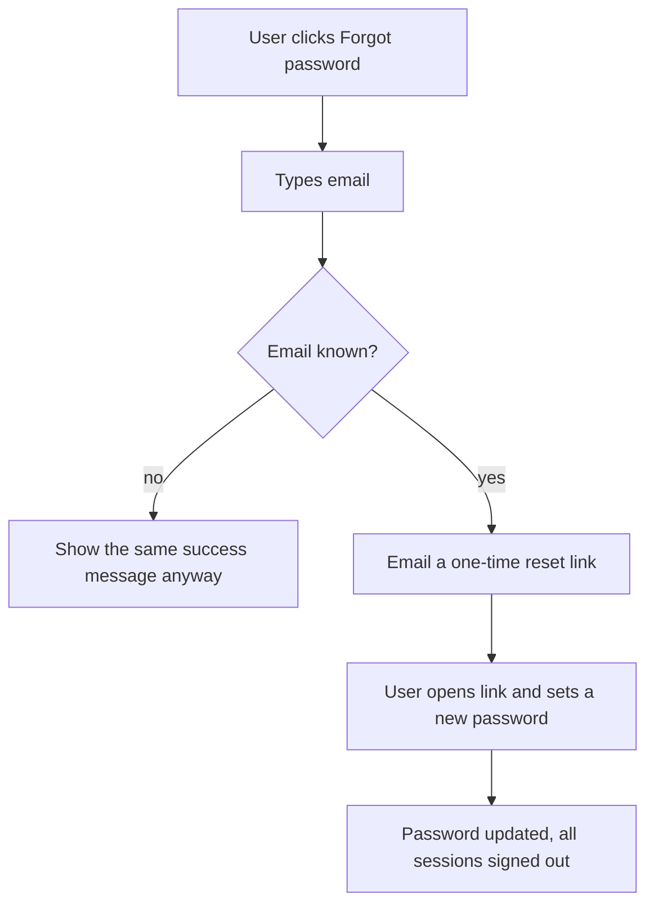

# Password reset by email

## In one paragraph

Today a user who forgets their password is stuck: there is no way back into their account. This
feature adds a "Forgot password?" link. The user types their email, we send them a one-time link,
and that link lets them set a new password. The link expires after one hour and can be used only
once. Without this, a forgotten password means a permanently locked account and a support ticket.

## Summary

Add a self-service password reset: request it by email, verify a one-time token, set a new password,
and sign out all existing sessions.

## Problem

Users who forget their password cannot sign in and have no way to recover. The only path today is a
manual support request, which is slow and does not scale.

## Goals

- A user who forgot their password can recover access without contacting support.
- Reset links are single-use and expire within one hour.

## Non-Goals

- Changing the password from inside the app while signed in (this already exists).
- SMS or authenticator-app recovery (email only for now).

## Users and Use Cases

- **Returning user:** forgot their password and wants back in quickly and safely.

## How It Works

The user asks for a reset. We email a one-time link. Opening that link with a new password resets the
account and signs every device out.



```
User clicks "Forgot password" -> types email
   email unknown? -> show the same success message anyway
   email known?   -> email a one-time reset link
                       -> user opens link + sets new password
                       -> password updated, all sessions signed out
```

## Glossary

- **Reset token** — a long random string inside the email link that proves the request is genuine.
- **Single-use** — works exactly once; a second attempt is rejected.
- **Session** — a signed-in state held by one browser or device.
- **Hash** — a one-way scramble of a password, so the real password is never stored.

## Functional Requirements

### REQ-001: Request a password reset

A signed-out user enters their email and asks for a reset link.

**What this means:** the user tells us their email, and we email them a special link if that email
has an account.

**Example:**
- Given the email `sam@example.com` has an account
- When Sam submits it on the "Forgot password?" screen
- Then Sam sees "If that email exists, we sent a link" and receives one email

#### Acceptance Criteria

- [ ] Submitting any email always shows the same message, so nobody can tell which emails exist
- [ ] A known email receives exactly one email within 60 seconds
- [ ] The email link contains a single-use token and states it expires in one hour
- [ ] More than 5 requests in 15 minutes for one email is rate-limited

### REQ-002: Set a new password with the link

Opening a valid link lets the user choose a new password.

**What this means:** clicking the emailed link shows a form to pick a new password.

**Example:**
- Given a valid, unused, unexpired token
- When the user submits the same 12-character password twice
- Then the password is stored as a hash, every session is signed out, and the token is marked used

#### Acceptance Criteria

- [ ] A valid token shows the "new password" form
- [ ] The new password is stored only as a hash, never in plain text
- [ ] After a successful reset, all existing sessions are signed out
- [ ] An expired (over one hour) token shows "This link has expired" and offers a new request
- [ ] An already-used token is rejected the same way as an invalid one

## Non-Functional Requirements

- **Security and privacy:** tokens are random (at least 128 bits) and single-use; responses never
  reveal whether an email exists.
- **Accessibility:** the reset form works with a keyboard and a screen reader.
- **Performance and reliability:** the email is queued and sent within 60 seconds; resetting works
  even if the user requests a link several times.

## Dependencies and Constraints

- Requires the email provider the app already uses for other transactional mail.
- Must use the existing users table and password-hashing function.

## Data, Migration, and Compatibility

- New table `password_reset_tokens` (`token_hash`, `user_id`, `expires_at`, `used_at`).
- No change to the `users` table.
- Rollback: drop the new table; no user data is lost.

## Testing and Validation

- Unit: token creation, expiry, single-use, and hashing.
- Integration: the full request → email → reset → sign-out flow.
- Security: the response for a known email and an unknown email is identical.

## Rollout and Observability

- Ships behind a feature flag `password_reset`. Metrics: resets completed per day, emails sent per
  request, and rate-limit hits.

## Risks

- **Email deliverability:** reset emails may land in spam. Mitigation: use the existing transactional
  sender and monitor bounce rates.

## Assumptions

- The app already sends transactional email for other features.

## Open Questions

- Should the email link open the app directly, or a web page first?
