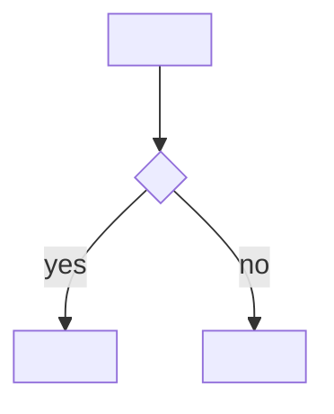

# <Feature or Product Name>

## In one paragraph

<Explain the whole feature in three to five plain sentences, as if to a smart friend who knows
nothing about the project. No jargon. This is the only part some readers will read.>

## Summary

<A slightly more precise version of the above: what changes, and the intended outcome.>

## Problem

<What is wrong or missing today, who feels it, and the evidence. Plain language.>

## Goals

- <An outcome you can observe or measure>

## Non-Goals

- <Something explicitly out of scope, and one line on why>

## Users and Use Cases

- **<Role>:** <what they do, and what they need from this feature>

## How It Works

<One or two sentences describing the flow.>



```
<ASCII fallback of the same flow>

<start> -> <decision>?
   yes -> <action>
   no  -> <other action>
```

## Glossary

- **<term>** — <plain definition>
- **<acronym>** — <full name>; <plain definition>

## Functional Requirements

### REQ-001: <Plain title>

<What the user can do, in plain language. Keep sentences short.>

**What this means:** <one sentence translating the requirement into everyday words.>

**Example:**
- Given <a specific input or situation>
- When <the user does something>
- Then <the exact observable result>

#### Acceptance Criteria

- [ ] <Observable, independently checkable result>
- [ ] <Relevant error or edge case, and what the user sees>
- [ ] <Applicable security, data, or compatibility behavior>

## Non-Functional Requirements

- **Security and privacy:** <requirement, or "Not applicable — <reason>">
- **Accessibility:** <requirement, or "Not applicable — <reason>">
- **Performance and reliability:** <requirement with a number, or "Not applicable — <reason>">

## Dependencies and Constraints

- <Dependency or constraint, and what it affects>

## Data, Migration, and Compatibility

<What data is created, read, changed, or deleted. How it migrates. What breaks, and the rollback.>

## Testing and Validation

- <How each requirement and its edge cases will be verified>

## Rollout and Observability

<How it ships, how you monitor it, who supports it, and how to roll back.>

## Risks

- **<Risk>:** <mitigation>

## Assumptions

- <A guess you made that still needs validation>

## Open Questions

- <An unresolved question that may change scope or behavior>
